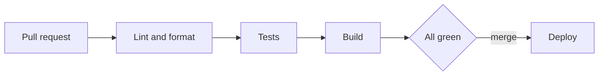

# {{PROJECT_NAME}} — Delivery Plan

**Version:** 1.0  
**Status:** ⬜ Draft  
**Planning step:** 10 — Delivery plan  
**Method:** Incremental delivery. Each increment ends with working, tested, deployable software. The backlog uses user stories that trace to requirements.

## 1. Increments and milestones

> **Guide:** increment 0 is always the foundation: project setup, database, CI, core layers, an app shell, and a first deployment. Order the rest so the most valuable, daily-usable part comes early. Protect real data (backups) before daily use starts.

| Inc | Name | Goal | Stories | Milestone |
|---|---|---|---|---|
| 0 | Foundation | {{GOAL}} | US-001 to US-{{N}} | — |
| 1 | {{NAME}} | {{GOAL}} | {{STORIES}} | {{MILESTONE}} |

### Parity rule

> **Guide:** keep if there is more than one client. Every user-facing story is delivered on every client in the same increment; the API is finished first.

## 2. Backlog

Format: *As a … I want … so that …*. Each story lists the requirements it delivers; its acceptance criteria are those requirements' criteria.

### Increment 0 — Foundation

| ID | Story | Requirements / ADR |
|---|---|---|
| US-001 | As the developer, I want {{SETUP GOAL}}. | {{ADR / QR}} |

## 3. Definition of Ready (story can start)

- The story traces to confirmed requirements, and any proposal it depends on is confirmed.
- Acceptance criteria are clear.
- Dependencies from earlier increments are done.
- The owner has given the go-ahead.

## 4. Definition of Done (story is finished)

1. Code follows the architecture, the ADRs, and the engineering handbook, including its review checklist.
2. Automated tests cover every listed requirement, tagged with its ID.
3. Lint, format, type checks, and all tests pass in CI.
4. The API contract and the implementation match.
5. New screens pass accessibility checks and work on small and large screens.
6. Migrations are reversible and applied to a fresh database.
7. Documentation and the story's status in `Planning/target_progress.md` are updated.
8. The change is deployed at the end of its increment.

## 5. Workflow

{{HOW CHANGES REACH MAIN; who manages version control}}

## 6. CI/CD pipeline

## 7. Release checklist

1. All exit criteria in the test strategy are met.
2. A fresh backup has just completed.
3. Migrations run on production.
4. Smoke test of the main journeys.
5. Release notes written; trackers updated.

## 8. Planning-to-build handover

1. The owner confirms planning steps 1 to 12.
2. The owner confirms or changes every proposed default.
3. Owner setup tasks for increment 0 are done.
4. The owner gives the go-ahead for coding.
