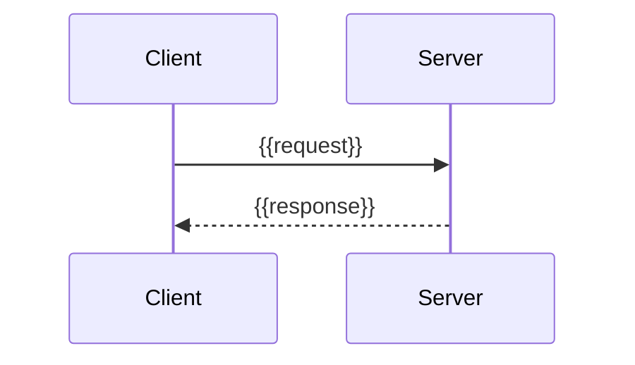

# {{PROJECT_NAME}} — Software Architecture

**Version:** 1.0  
**Status:** ⬜ Draft  
**Planning step:** 6 — Architecture  
**Method:** C4 model (context, containers, components) plus Architecture Decision Records in `ADR/`. Diagrams use Mermaid.

## 1. Architectural drivers

> **Guide:** the requirements and constraints that shape the architecture most, and the response to each.

| Driver | Source | Architectural response |
|---|---|---|
| {{DRIVER}} | {{D-, QR-, or FR- ID}} | {{RESPONSE (ADR-xxx)}} |

## 2. Level 1 — System context

```mermaid
flowchart TB
  user([{{User}}])
  sys[[{{PROJECT_NAME}}]]
  ext[({{External system}})]
  user --> sys
  sys --> ext
```

## 3. Level 2 — Containers

```mermaid
flowchart TB
  client([{{Client}}])
  api[{{Backend}}]
  db[({{Database}})]
  client --> api --> db
```

| Container | Technology | Responsibility |
|---|---|---|
| {{CONTAINER}} | {{TECHNOLOGY}} | {{RESPONSIBILITY}} |

## 4. Level 3 — Components

> **Guide:** one subsection per container with its modules and the layer rules that apply inside it.

### 4.1 {{CONTAINER}}

| Module | Responsibility |
|---|---|
| {{MODULE}} | {{RESPONSIBILITY}} |

## 5. Runtime views

> **Guide:** sequence diagrams for the 2 to 4 most important or riskiest flows, such as sign-in or a multi-step save.



## 6. Deployment

```mermaid
flowchart LR
  dev[Developer] --> ci[CI] --> prod[{{Hosting}}]
```

| Environment | Database | Purpose |
|---|---|---|
| Local | {{DATABASE}} | Development |
| CI | {{DATABASE}} | Automated tests |
| Production | {{DATABASE}} | Live service |

## 7. Cross-cutting concepts

| Concern | Approach |
|---|---|
| Authentication | {{APPROACH}} |
| Authorization | {{APPROACH}} |
| Validation | {{APPROACH}} |
| Errors | {{APPROACH}} |
| Concurrency | {{APPROACH}} |
| Time and time zones | {{APPROACH}} |
| Logging | {{APPROACH}} |
| Configuration | {{APPROACH}} |
| Backups | {{APPROACH}} |

## 8. ADR index

| ADR | Title | Status |
|---|---|---|
| [ADR-001](ADR/ADR-001-{{slug}}.md) | {{TITLE}} | Proposed |

## 9. Changes required to the starting template

> **Guide:** if the project starts from an existing template, list what must change and which ADR decides it.

| Area | Change | ADR |
|---|---|---|
| {{AREA}} | {{CHANGE}} | {{ADR}} |

## Change history

- **v1.0 ({{DATE}}):** First version.
