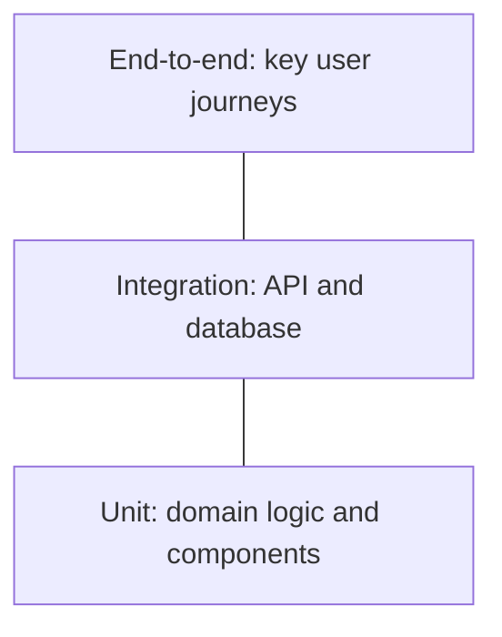

# {{PROJECT_NAME}} — Test Strategy

**Version:** 1.0  
**Status:** ⬜ Draft  
**Planning step:** 9 — Test strategy  
**Standard:** Structure follows ISO/IEC/IEEE 29119-3: scope, levels, techniques, environments, criteria.

## 1. Goals

1. Prove every functional requirement with at least one automated test.
2. Make the most critical rules impossible to break silently: {{e.g. data isolation between users}}.
3. Keep tests fast enough to run on every pull request.

## 2. Scope

| In scope | Out of scope for V1 |
|---|---|
| {{PART}} | {{EXCLUDED TESTING}} |

## 3. Test levels

| Level | Tools | What is tested | When |
|---|---|---|---|
| Unit | {{TOOLS}} | Domain logic, value objects, components | Every commit |
| Integration | {{TOOLS}} | Every endpoint: status codes, payloads, errors, ownership | Every commit |
| Contract | {{TOOLS}} | API matches the OpenAPI contract | Every pull request |
| End-to-end | {{TOOLS}} | Journeys from the use cases | Every pull request to main |
| Accessibility | {{TOOLS}} | WCAG 2.1 AA rules | Every pull request |
| Performance | {{TOOLS}} | Quality requirement targets | Before release |
| Security | {{TOOLS}} | Dependency audit, secret scan, ASVS checklist | Every pull request; checklist before release |
| Backup restore | {{TOOLS}} | Full restore works | {{e.g. monthly and before release}} |

## 4. Critical test suites

> **Guide:** one subsection per rule that must never break. Typical suites: data isolation between users, the most important business invariant, time and time zones, money arithmetic, authentication and sessions, backup and restore.

### 4.1 {{SUITE NAME}}

| Case | Expected |
|---|---|
| {{CASE}} | {{EXPECTED RESULT}} |

## 5. Requirement traceability

- Every test name includes its requirement ID, for example `test_fr_area_001_rejects_invalid_input`.
- A CI check fails if any FR ID has no test.

## 6. Test data

- Factories or builders for test data.
- A seed command for realistic local data, never available in production.
- Production data is never copied into development or tests.

## 7. Environments

| Environment | Database | Notes |
|---|---|---|
| Local | {{DATABASE}} | {{NOTES}} |
| CI | {{DATABASE}} | Same major version as production |

## 8. Entry and exit criteria

**A pull request can be merged when** lint, format, type checks, and all automated tests pass, and coverage targets are met.

**A release can ship when** all tests pass on main, performance and security checks are done, a restore drill succeeded recently, and every FR has a passing test.

## 9. Defect handling

| Severity | Definition | Rule |
|---|---|---|
| Critical | Data loss, data leak, security hole | Fix first; release blocked |
| High | Core flow broken, no workaround | Release blocked |
| Medium | Flow broken with a workaround | Fix in the current or next increment |
| Low | Cosmetic | Backlog |

Every fixed defect gets a regression test.

## Change history

- **v1.0 ({{DATE}}):** First version.
